# Pipeline ETL para uma empresa SaaS B2B (Python + Pandas + MySQL)

Projeto de engenharia de dados que simula o dia a dia de uma empresa SaaS: um banco MySQL com clientes, assinaturas, faturas e pagamentos, **propositalmente sujo**, que passa por um pipeline **ETL** (Extract, Transform, Load) em Python e termina com métricas de negócio (MRR e churn).

> ⚠️ Todos os dados deste projeto são **sintéticos**, gerados com a biblioteca Faker. Nenhuma pessoa ou empresa real está representada.

## Resultados em destaque

| Indicador | Resultado |
|---|---|
| Tabelas no banco | 8 (cerca de 28 mil registros) |
| Problemas de qualidade injetados e tratados | 9 tipos |
| Datas de pagamento recuperadas cruzando tabelas | 80 |
| Valores de assinatura corrigidos | 66 |
| MRR atual | ≈ R$ 64,5 mil |
| Taxa de cancelamento | 28,7% (201 de 700 assinaturas) |
| Churn mensal (últimos 12 meses) | 3,6% ao mês |
| LTV médio de uma assinatura paga | ≈ R$ 5,0 mil (Enterprise: ≈ R$ 14,4 mil) |

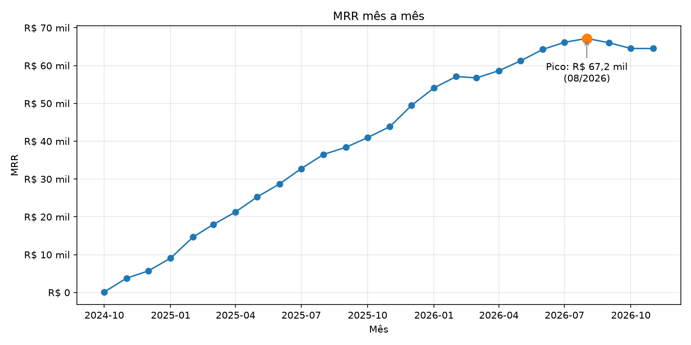

## Objetivo

Praticar o ciclo completo de um pipeline de dados:

1. Modelar e popular um banco relacional realista
2. Extrair os dados do MySQL com Python
3. Diagnosticar e corrigir problemas de qualidade com Pandas
4. Salvar o resultado limpo (CSV e novas tabelas no MySQL)
5. Calcular métricas de negócio em cima dos dados limpos

## Arquitetura

```
MySQL (schema saas, 8 tabelas)
        │
        ▼
  extract.py     →  lê as tabelas (SQLAlchemy + PyMySQL + pd.read_sql)
        │
        ▼
  transform.py   →  limpa, padroniza, marca e corrige (Pandas)
        │
        ▼
  pipeline.py    →  carrega o resultado
        │
        ├──► dados_limpos/*.csv
        └──► tabelas *_limpo no MySQL
                    │
                    ▼
        metricas.py e grafico_mrr.py  →  MRR, churn e gráfico
        churn_ltv.py                  →  churn mês a mês e LTV por plano
```

O `pipeline.py` roda as três etapas com um único comando e pode ser executado várias vezes sem duplicar dados (as tabelas `_limpo` são recriadas a cada execução).

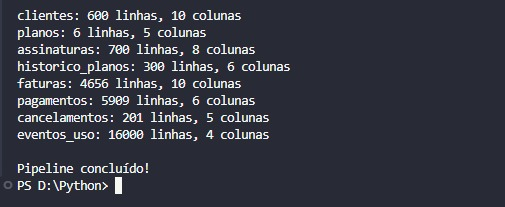

## Tecnologias

- Python
- Pandas
- SQLAlchemy e PyMySQL (leitura e escrita no banco com Pandas)
- mysql-connector-python (scripts de geração de dados)
- Faker (dados sintéticos)
- python-dotenv (credenciais fora do código)
- Matplotlib (gráfico)
- MySQL 8 e MySQL Workbench

## Banco de dados

Empresa SaaS B2B fictícia, com o ciclo completo do cliente: cadastro, assinatura, cobrança, uso e cancelamento.

| Tabela | O que guarda |
|---|---|
| `clientes` | Empresas clientes: segmento, porte, estado, data de cadastro |
| `planos` | Free, Basic, Pro e Enterprise, mensais e anuais, com preço |
| `assinaturas` | Qual cliente assina qual plano, valor, datas e status |
| `historico_planos` | Upgrades e downgrades de plano |
| `faturas` | Cobranças mensais de cada assinatura |
| `pagamentos` | Tentativas de pagamento de cada fatura (sucesso ou falha) |
| `cancelamentos` | Data, motivo e tipo (voluntário ou involuntário) |
| `eventos_uso` | Logins e uso das funcionalidades do produto |

O script de criação está em [`sql/schema.sql`](sql/schema.sql).

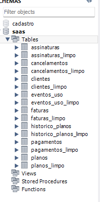

## Dados sintéticos e sujeira proposital

Os dados foram gerados com Python e Faker (scripts em [`geracao_dados/`](geracao_dados/)). Depois, scripts de `UPDATE` injetaram problemas de qualidade que existem em bancos reais. Essa lista serve de **gabarito**: o ETL precisa encontrar e tratar cada item.

| Tabela | Problema injetado | Injetado | Encontrado pelo ETL |
|---|---|---|---|
| clientes | E-mails vazios | 40 | 40 |
| clientes | E-mails duplicados | 20 | 17 pares (34 linhas marcadas) |
| clientes | Nomes com espaços sobrando e letras bagunçadas | ~180 | 60 com espaço, 54 em maiúsculo |
| assinaturas | Status escrito de formas diferentes (`ATIVA`, `Ativa`) | 80 | padronizados |
| assinaturas | Valor diferente do preço do plano | ~10% | 66 |
| faturas | Status `Paga` com maiúscula | 60 | 60 |
| faturas | Faturas pagas sem data de pagamento | 50 | 50 |
| faturas | Valores negativos | 25 | 25 |
| faturas | Pagamento anterior ao vencimento | 30 | 30 |

As pequenas diferenças (por exemplo, 20 injetados contra 17 encontrados) acontecem porque o sorteio dos `UPDATE`s pode atingir a mesma linha mais de uma vez.

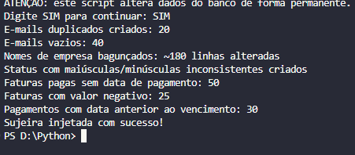

Antes de limpar, o `explorar.py` mede o tamanho do problema (valores vazios, duplicados, tipos errados):

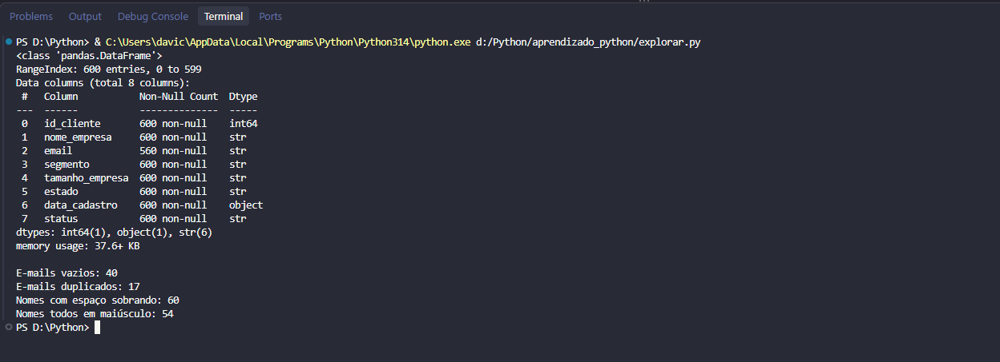

## O que o Transform faz

| Problema | Tratamento |
|---|---|
| Nomes de colunas com maiúsculas misturadas | Padronizados em minúsculo |
| Nomes de empresa com espaços e caixa irregular | `strip` e `title` |
| E-mails vazios e duplicados | **Marcados** em colunas `email_ausente` e `email_duplicado` (nenhuma linha é apagada) |
| Status com maiúsculas e minúsculas diferentes | Padronizados em minúsculo |
| Datas lidas como texto | Convertidas para `datetime` |
| Valores negativos em faturas | Marcados em `valor_negativo` e corrigidos |
| Pagas sem data e pagamentos antes do vencimento | Marcados e **recuperados cruzando com `pagamentos`** (`merge`) |
| Valor da assinatura diferente do preço do plano | Marcado em `valor_divergente` e corrigido cruzando com `planos` |

Princípio adotado: **primeiro marcar, depois corrigir**. Quem for analisar os dados consegue ver exatamente quais linhas foram alteradas.

A recuperação das datas usa a tabela `pagamentos`, que guarda a data da tentativa que deu certo. O `merge` não pode duplicar linhas, e isso é conferido: a tabela de faturas tem 4.656 linhas antes e depois.

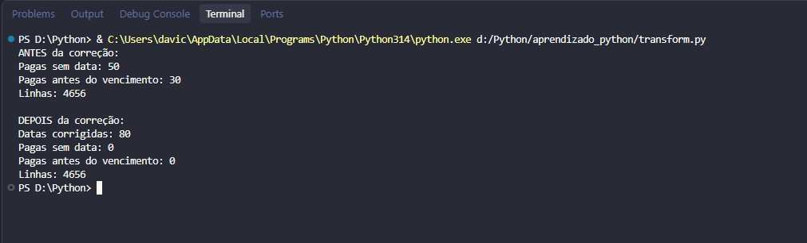

## Um bug que encontrei e como resolvi

A validação do Transform apontou **3.778 faturas pagas antes do vencimento**, quando o esperado eram 30. Os números eram regulares demais para ser acaso: o resumo estatístico da diferença entre as datas mostrou média de -28 dias, ou seja, praticamente todas as faturas pagas estavam cerca de 1 mês antes do vencimento.

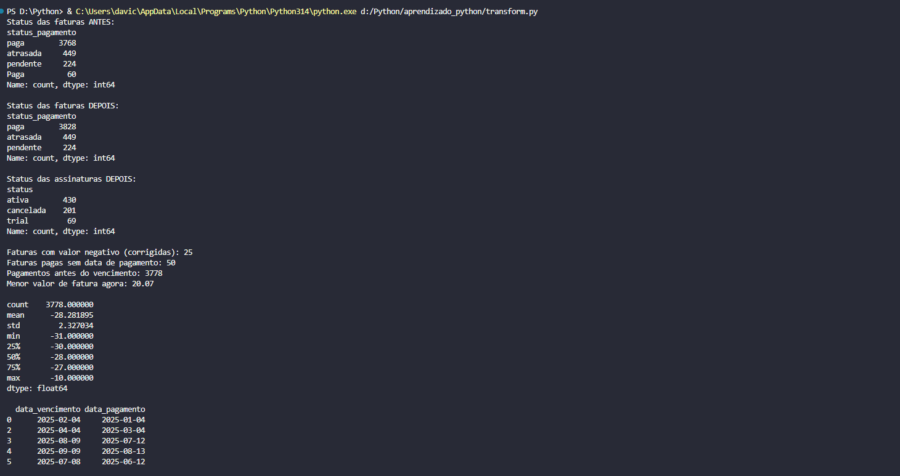

**Causa:** no script que gera as faturas, a linha que avança a data em um mês estava **antes** da linha que guarda a fatura. O pagamento era calculado com a data antiga e o vencimento era salvo com a data já avançada.

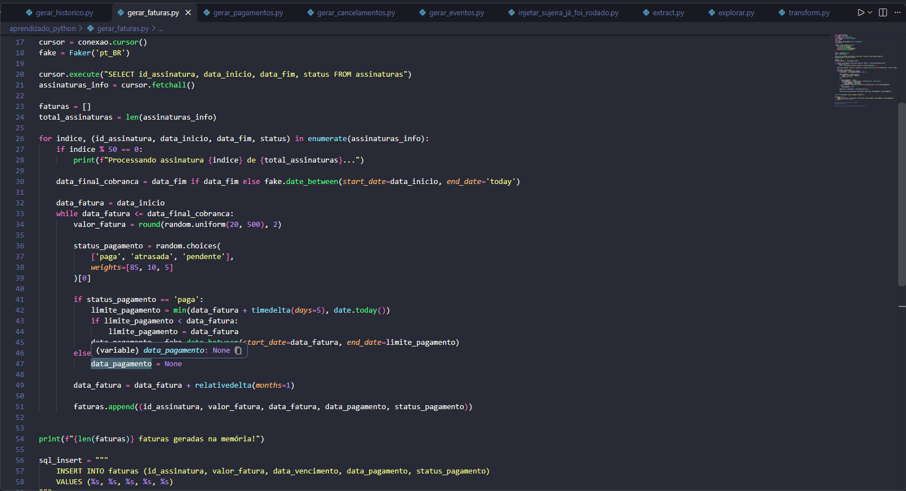

**Correção na origem:**

1. Inverter a ordem das duas linhas no script
2. Apagar as tabelas `pagamentos` e `faturas` (primeiro a "filha", por causa da chave estrangeira)
3. Gerar faturas e pagamentos de novo
4. Reinjetar a sujeira apenas nas faturas
5. Rodar o ETL de novo

**Conferências depois do conserto:**

- Faturas pagas antes do vencimento no banco limpo: **0**
- Pagamentos com sucesso (3.955) = faturas pagas (3.955), as duas tabelas concordam
- O ETL passou a detectar exatamente os **30** casos injetados

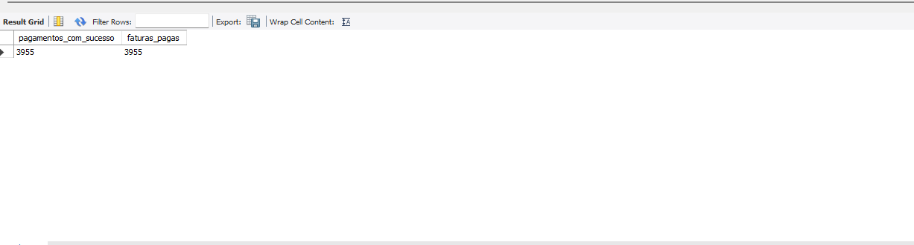

Aprendizado: quando um número não bate com o esperado, o problema pode estar nos dados de origem, e não só no código de análise. Validar o resultado antes de seguir evita construir em cima de um erro.

## Resultados

Métricas calculadas sobre as tabelas limpas (`metricas.py`):

**MRR (receita recorrente mensal) das assinaturas ativas**

| Plano | MRR |
|---|---|
| Enterprise | R$ 37.492,50 |
| Pro | R$ 20.786,13 |
| Basic | R$ 6.237,50 |
| Free | R$ 0,00 |

Planos anuais entram divididos por 12.

**Cancelamentos (201 de 700 assinaturas, 28,7%)**

| Tipo | Quantidade |
|---|---|
| Voluntário | 150 |
| Involuntário (falha de pagamento) | 51 |

| Motivo | Quantidade |
|---|---|
| Falha de pagamento | 51 |
| Insatisfação com o suporte | 45 |
| Preço alto | 44 |
| Falta de recurso | 37 |
| Migrou para concorrente | 24 |

**O que os números mostram**

- O plano Enterprise gera cerca de 58% do MRR
- 1 em cada 4 cancelamentos (25%) foi involuntário, causado por falha de pagamento. Recuperar esses pagamentos seria a forma mais direta de reduzir o churn

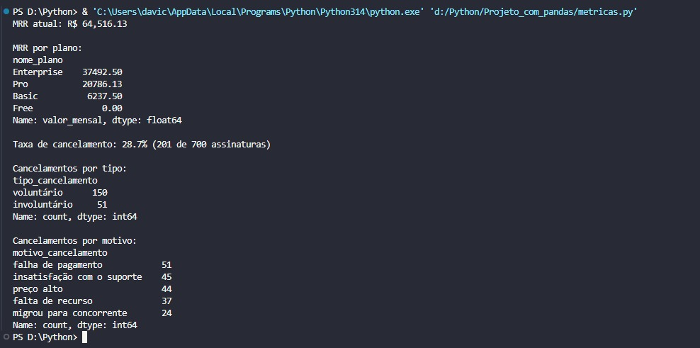

## Churn mensal e LTV

A taxa de 28,7% acima soma todo o período num número só e não mostra **quando** os clientes saíram. O `churn_ltv.py` calcula o churn **mês a mês**, que é como empresas SaaS acompanham essa métrica, e a partir dele o **LTV**.

**Como o churn mensal é calculado**

```
churn do mês = assinaturas que cancelaram no mês ÷ assinaturas ativas no dia 1º do mês
```

- Entram só assinaturas **pagas** (trial e plano Free não geram receita).
- "Ativa no dia 1º" usa a mesma regra do gráfico de MRR, então os dois números conversam.
- Também é calculado o **churn de receita**: quanto do MRR foi perdido no mês. Ele pesa mais quando sai um cliente Enterprise do que um Basic.
- O churn médio soma os cancelamentos e as bases de 12 meses antes de dividir, para que meses com poucos clientes não distorçam a média.

Conferência: a base de cada mês bate com a do mês anterior menos os cancelamentos mais as assinaturas novas.

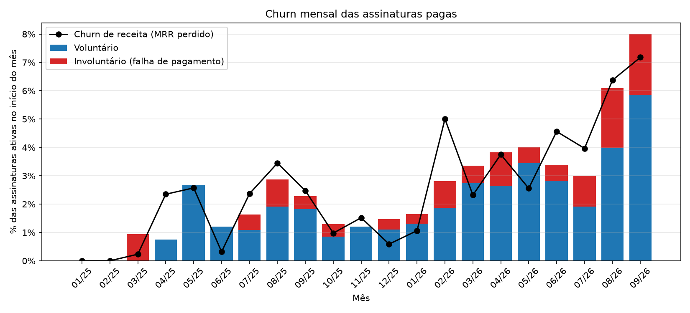

**Resultados (out/2025 a set/2026)**

- Churn médio de **3,6% ao mês** (clientes e receita)
- O churn sobe ao longo do tempo: fica entre 1% e 2% até jan/2026 e chega a **6,1% em ago/2026 e 8,0% em set/2026**. Isso explica por que o MRR para de crescer depois de ago/2026
- 26% dos cancelamentos do período (36 de 138) são **involuntários**, por falha de pagamento

**LTV (Lifetime Value)**

O LTV estima quanto uma assinatura gera de receita durante todo o tempo em que fica ativa:

```
vida média (meses) = 1 ÷ churn mensal
LTV = ticket mensal médio × vida média
```

| Plano | Ticket mensal | Churn mensal | Vida média | LTV |
|---|---|---|---|---|
| Enterprise | R$ 500 | 3,47% | 29 meses | R$ 14.426 |
| Pro | R$ 138 | 3,89% | 26 meses | R$ 3.536 |
| Basic | R$ 46 | 3,29% | 30 meses | R$ 1.392 |
| **Geral** | **R$ 177** | **3,57%** | **28 meses** | **R$ 4.969** |

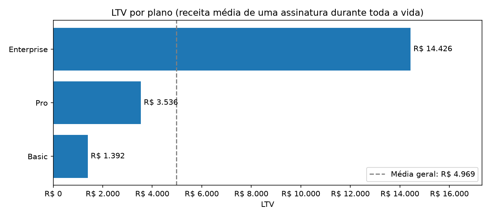

**O que os números mostram**

- Os planos têm churn parecido (de 3,3% a 3,9%), então a diferença de LTV vem quase toda do preço: uma assinatura Enterprise vale cerca de **10 vezes** uma Basic
- Com o churn subindo nos últimos meses, o LTV real das novas assinaturas tende a ser menor que o da tabela. Reduzir o churn, a começar pelas falhas de pagamento, é a alavanca mais importante

## Estrutura do repositório

```
├── README.md
├── requirements.txt
├── .env.example
├── .gitignore
├── sql/
│   └── schema.sql
├── geracao_dados/
│   ├── gerar_clientes.py
│   ├── gerar_planos.py
│   ├── gerar_assinaturas.py
│   ├── gerar_historico.py
│   ├── gerar_faturas.py
│   ├── gerar_pagamentos.py
│   ├── gerar_cancelamentos.py
│   ├── gerar_eventos.py
│   ├── injetar_sujeira_clientes_assinaturas.py
│   └── injetar_sujeira_faturas.py
├── dados_limpos/            (CSVs gerados pelo pipeline)
├── imagens/
├── extract.py
├── transform.py
├── pipeline.py
├── explorar.py
├── metricas.py
├── grafico_mrr.py
├── churn_ltv.py
└── teste_conexao.py
```

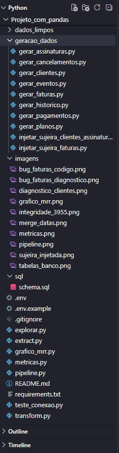

## Como executar

**Pré-requisitos:** Python 3.10 ou superior e MySQL 8.

```bash
git clone https://github.com/davicarneiroc4-star/etl-saas-pandas-mysql.git
cd etl-saas-pandas-mysql
pip install -r requirements.txt
```

1. **Credenciais:** copie `.env.example` para `.env` e preencha com os dados do seu MySQL. O `.env` não vai para o repositório.
2. **Banco:** execute o arquivo `sql/schema.sql` no MySQL (por exemplo, no Workbench).
3. **Dados (opcional):** os scripts de `geracao_dados/` foram executados uma única vez. Para **não duplicar dados**, as três últimas linhas de cada gerador (`executemany`, `commit` e o `print` final) estão comentadas. Para reproduzir, descomente essas linhas e rode **nesta ordem**:
   `gerar_clientes`, `gerar_planos`, `gerar_assinaturas`, `gerar_historico`, `gerar_faturas`, `gerar_pagamentos`, `gerar_cancelamentos`, `gerar_eventos`, `injetar_sujeira_clientes_assinaturas` e `injetar_sujeira_faturas`.
   Rodar um gerador duas vezes duplica os dados daquela tabela.
4. **Pipeline:** com o banco populado, rode o ETL completo:

```bash
python pipeline.py
```

5. **Métricas e gráfico:**

```bash
python metricas.py
python grafico_mrr.py
python churn_ltv.py
```

Os gráficos são salvos na pasta `imagens/`.

## Limitações

- **Dados sintéticos.** A curva de MRR (crescendo a partir de zero e caindo levemente no final) é em parte efeito da geração: as datas de início de assinatura vão até 1 mês antes de hoje, então não entram clientes novos nos últimos meses, enquanto os cancelamentos continuam.
- O `valor_fatura` foi sorteado e **não tem relação** com o `valor_assinatura`. Por isso o MRR é calculado a partir da tabela `assinaturas`, e não de `faturas`.
- A taxa de cancelamento de 28,7% é **simplificada** (cancelamentos sobre o total de assinaturas). O churn mês a mês está em [Churn mensal e LTV](#churn-mensal-e-ltv).
- Os cancelamentos foram gerados até set/2026, por isso a análise de churn para nesse mês: incluir outubro daria um churn de 0% falso. A alta do churn nos últimos meses também é, em parte, efeito da geração (as datas de cancelamento foram sorteadas até a data de criação dos dados).
- 13 assinaturas pagas começaram e cancelaram no mesmo mês. Como não estavam ativas no dia 1º, não entram no churn mensal, que é a convenção usual.
- O LTV é de **receita** (não desconta custos) e assume que o churn continua igual ao dos últimos 12 meses.
- A correção do valor de assinatura assume que a divergência é erro. Em um caso real, poderia ser um desconto legítimo.
- Os scripts de geração não são idempotentes: rodar de novo duplica dados.

## Próximos passos

- Análise de coorte: acompanhar quanto de cada turma de clientes continua ativa mês a mês
- Script único para limpar e recriar o banco do zero
- Testes automatizados para as funções de transformação
- Agendar o pipeline com Apache Airflow
- Empacotar o projeto com Docker

## Autor

**Davi**, estudante de Análise e Desenvolvimento de Sistemas.

GitHub: [davicarneiroc4-star](https://github.com/davicarneiroc4-star)

